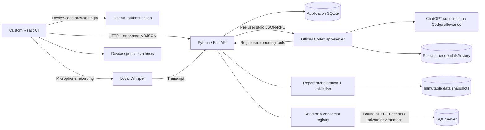

# Architecture

Frontend assets, Python, Codex, and Whisper run inside **one Docker container**. Internet is needed for OpenAI login/inference and the initial Whisper download. Node launches the packaged CLI; business logic is Python.

## Subscription boundary

Python does not directly call OpenAI inference endpoints. It drives the pinned Codex app-server through `initialize`, `account/read`, device-code `account/login/start`, `model/list`, thread start/resume, turn start/interrupt, and streamed notifications. Managed Codex auth handles renewal.

Each user gets `/data/codex/<UUID>` and their own runtime. An allowlisted child environment excludes host API keys/access tokens and all SQLSERVER credentials. `forced_login_method="chatgpt"` and runtime type checks reject API-key accounts. The UI only receives account/plan status, verification URL/code, model catalog, and requested usage windows. This consumes the subscription's Codex allowance and does not bypass limits or scrape ChatGPT sessions.

Disconnect clears provider-thread associations so another ChatGPT account never inherits provider identities. Continuing a local conversation after reconnect replays completed local history into a fresh thread. Existing website conversations/memories are not imported.

## Conversations

Authenticate user → check conversation ownership/subscription → serialize turns → start/resume provider thread → save user message → stream assistant deltas → validate completed status → persist final text/status.

Heartbeat events keep idle streams alive. Provider failures/timeouts/disconnects produce explicit errors; failed/interrupted turns are not labeled completed. The browser can interrupt a running turn.

Shell, code mode, web search, patch, and multi-agent features are disabled. Only registered reporting tools are advertised; unknown server requests are rejected. The `duka_read_only` permission profile allows reads only in the user's empty workspace, with no write grants and command network access disabled. Thread creation, resume, and turn requests select it using `permissions`; deprecated `readOnly.access` and legacy sandbox overrides are not sent. A shared local container is a trusted deployment boundary, not a hardened sandbox for unrelated hostile tenants.

## Voice

`MediaRecorder` captures bounded recordings, optionally using RMS silence detection. Python transcribes locally. Transcript text follows the ordinary chat path. Device `speechSynthesis` reads replies; conversation mode listens again after playback to reduce echo. No Realtime API, cloud audio transcription API, or paid cloud TTS is configured. Browser/OS speech availability and latency vary.

## Reports

Request → authorized database query/dataset/manual rows → immutable snapshot → deterministic decimal summary → subscription generation with strict JSON schema → independent Pydantic validation → stored report → Markdown/JSON/source-CSV export.

No-data jobs stop before inference as `blocked`. Failed generation produces no downloadable report. CSV escaping protects against formula injection. The backend owns provenance; model output cannot replace it. Numeric sums are deterministic; narrative interpretations need review.

## Database tools

`duka_reporting.list_sources`, `list_tables`, and `describe_table` discover real tables/views, column types, and foreign keys under source-level authorization. `query_database` invokes a Python query compiler: identifiers must exist in discovered metadata, aliases/functions/operators are constrained, identifiers are quoted, and filter values are bound. It supports joins, date buckets, grouped aggregate metrics, ordering and bounded previews. It cannot execute model-authored SQL or code.

`create_database_report` calls the shared report orchestrator with a source and structural query. It captures rows, source ID, normalized query, output types, scope and timestamp in an immutable snapshot; report generation uses a separate subscription thread and defaults to Albanian. Truncated preview results cannot be saved as complete reports. No manually defined dataset is required. Administrators have access to connected sources; members require explicit `source_grants` for database-wide analysis. Dataset-specific grants remain independent for legacy curated queries.

`duka_reporting.list_datasets` returns only granted dataset IDs, descriptions, status, and parameter/column schemas. `fetch_dataset` validates parameters and executes the approved backend query. `create_report` shares the same authorization, snapshot, and generation path as the report form. It returns a queued/blocked report ID, while background generation runs on a separate Codex thread using the user's subscription. Opening Reports refreshes jobs created from chat.

SQL Server sources use independent encrypted settings entered through the administrator source form. Configured SQL values from `.env` are authoritative; encrypted per-source settings are used when no SQL environment connection is configured. The file is mounted read-only and parsed privately with literal password preservation. Backend connection resolution refreshes changed SQL settings. The private data volume holds the source credential key; missing keys fail closed. Saved credentials are absent from API responses, model prompts, audit events, child environments, and provider workspaces. Connection failures are categorized without exposing raw driver text. The SQL login must enforce SELECT-only permissions; the driver's read-only routing hint and script validation do not replace database permissions. Query keys map to operator-controlled SQL/JSON files. Model-generated SQL is never executed. Results over 500 rows or 100 KB are rejected, not silently summarized as complete datasets.

## Users and administration

First setup creates an admin with a user-chosen password; setup is then locked. Admins manage members, source/dataset definitions/grants, service counts, and audit metadata. Audit records exclude message content and credentials. Members cannot access other users' chats/reports or ungranted datasets.

Passwords use salted scrypt. Session tokens are random and stored only as hashes, with HttpOnly/SameSite cookies and configurable Secure flags. Browser writes require an app-specific header and exact-origin checks. Frontend state is discarded on member switches.

Run **one Uvicorn worker**: locks, Codex runtimes, local speech serialization, and report jobs are in-process. Startup marks unfinished messages interrupted and unfinished reports failed. Introduce a dedicated task queue/runtime coordinator before using multiple workers.
