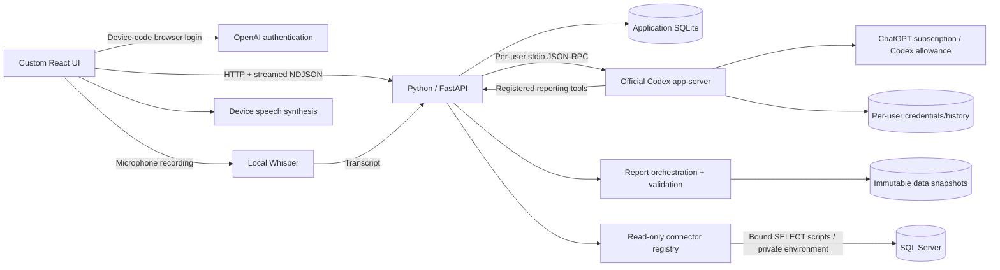

# Architecture

Nginx serves the compiled React frontend and proxies `/api/` to the Python backend on `127.0.0.1:8080`. systemd runs the backend as the restricted `duka` user; model processes and optional transcription run beneath it. Persistent data and runtime.env live under `/var/lib/duka-agent`. Internet is needed for provider login/inference/web search and optional model downloads. Node launches the packaged CLI; business logic is Python. See the complete [deployment guide](../DEPLOYMENT.md).

## Subscription boundary

Python does not directly call OpenAI inference endpoints. It drives the pinned Codex app-server through `initialize`, `account/read`, device-code `account/login/start`, `model/list`, thread start/resume, turn start/interrupt, and streamed notifications. Managed Codex auth handles renewal.

Devs manage shared workspace subscription connections, adopted in place from the original Devs credential directories. Each chat/report still gets its own runtime, acting member ID, and member-specific working directory. Shared native history is never exposed through member APIs; local ownership checks and database/company grants remain per user. An allowlisted child environment excludes host API keys/access tokens and all SQLSERVER credentials. `forced_login_method="chatgpt"` and runtime type checks reject API-key accounts. Only Devs receive account/plan details, verification URLs/codes and usage windows. Other members receive connection availability and model capabilities without account or pending-login details. This consumes the subscription's Codex allowance and does not bypass limits or scrape ChatGPT sessions.

Disconnect clears provider-thread associations so another ChatGPT account never inherits provider identities. Continuing a local conversation after reconnect replays completed local history into a fresh thread. Existing website conversations/memories are not imported.

## Conversations

Authenticate user → check conversation ownership/subscription → serialize turns → start/resume provider thread → save user message → stream assistant deltas → validate completed status → persist final text/status.

Heartbeat events keep idle streams alive. Provider failures/timeouts/disconnects produce explicit errors; failed/interrupted turns are not labeled completed. The browser can interrupt a running turn.

Public web search is enabled through provider-native tools alongside registered reporting tools. Shell, code mode, patch and multi-agent features are disabled; unknown server requests are rejected. The `duka_read_only` permission profile is passed as a process-specific CLI override so users cannot overwrite each other's filesystem policy in shared config. It allows reads only in the user's empty workspace, with no write grants and command network access disabled. Thread creation, resume, and turn requests select it using `permissions`; deprecated `readOnly.access` and legacy sandbox overrides are not sent. The shared backend service is a trusted deployment boundary, not a hardened environment for unrelated hostile tenants.

## Voice

`MediaRecorder` captures bounded recordings, optionally using RMS silence detection. Python transcribes locally. Transcript text follows the ordinary chat path. Device `speechSynthesis` reads replies; conversation mode listens again after playback to reduce echo. No Realtime API, cloud audio transcription API, or paid cloud TTS is configured. Browser/OS speech availability and latency vary.

## Reports

Request → authorized database query/dataset/manual rows → immutable snapshot → deterministic decimal summary → subscription generation with strict JSON schema → independent Pydantic validation → stored report → Markdown/JSON/source-CSV export.

No-data jobs stop before inference as `blocked`. Failed generation produces no downloadable report. CSV escaping protects against formula injection. The backend owns provenance; model output cannot replace it. Numeric sums are deterministic; narrative interpretations need review.

## Database tools

`duka_reporting.list_sources`, `list_tables`, and `describe_table` discover real tables/views, column types, and foreign keys under source-level authorization. `query_database` invokes a Python query compiler: identifiers must exist in discovered metadata, aliases/functions/operators are constrained, identifiers are quoted, and filter values are bound. It supports joins, date buckets, grouped aggregate metrics, ordering and bounded previews. It cannot execute model-authored SQL or code.

`create_database_report` calls the shared report orchestrator with a source and structural query. It captures rows, source ID, normalized query, output types, scope and timestamp in an immutable snapshot; report generation uses a separate subscription thread and defaults to Albanian. Truncated preview results cannot be saved as complete reports. No manually defined dataset is required. Administrators have access to connected sources; members require explicit `source_grants` for database-wide analysis. Dataset-specific grants remain independent for legacy curated queries.

`duka_reporting.list_datasets` returns only granted dataset IDs, descriptions, status, and parameter/column schemas. `fetch_dataset` validates parameters and executes the approved backend query. `create_report` shares the same authorization, snapshot, and generation path as the report form. It returns a queued/blocked report ID, while background generation runs on a separate Codex thread using the user's subscription. Opening Reports refreshes jobs created from chat.

Named-company requests first use `resolve_company_access`, shared by ChatGPT and Claude. The backend privately scans enabled SQL Server/HANA database and ERP identity catalogs, including sources the member cannot query, then checks the acting member's current grants. Only authorized matches or a generic denial reach the model; restricted identities, connection errors and business records are excluded. Matching ignores case, diacritics and punctuation between initials (for example D&D / D & D), and accepts a short name at a word boundary. Ambiguous names never authorize substituting another company. Unknown names and incomplete discovery remain distinct from denied access. Catalog lookups do not cache grants or change them, and ordinary read/export authorization remains mandatory. Older resumed Codex tool catalogs can invoke the same check through `discover_sales` with an empty `source_id` and the requested `company`; this compatibility path does not inspect sales or create reports.

When a compound name has no direct company match, the resolver checks its longest matching company-name prefix and returns `scope_required` with authorized candidates and the remaining qualifier. For example, “Gotech Fier” can identify a location inside “Gotech Live”; this result does not approve the location or authorize company-wide totals. The model must verify the qualifier against actual authorized location/branch records and retain that scope in queries and calculations, or ask for clarification. Direct matches to a restricted legal company take precedence over this fallback. A global `catalog_complete=false` caused by unrelated source discovery does not invalidate an independently verified authorized candidate.

SQL Server/HANA sources use private environment profiles entered through the administrator source form. Native production stores them in `/var/lib/duka-agent/runtime.env`; local development uses the ignored project `.env`. Form-configured sources retain independent `DUKA_CONNECTION_<ID>_` profiles. The backend parses values privately with literal password preservation and refreshes changed source settings. Old encrypted rows migrate to environment profiles; the legacy key remains in the private data directory for backup recovery. Saved credentials are absent from API responses, model prompts, audit events, child environments and provider workspaces. Connection failures are categorized without exposing raw driver text. Database logins must enforce SELECT-only permissions; driver routing hints and script validation do not replace database privileges. Query keys map to operator-controlled SQL/JSON files. Model-generated raw SQL is not executed. Previews are bounded and explicitly marked; complete reports run the validated query independently and reject incomplete snapshots.

## Users and administration

First setup creates an admin with a user-chosen password; setup is then locked. Admins manage members, source/dataset definitions/grants, service counts, and audit metadata. Audit records exclude message content and credentials. Members cannot access other users' chats/reports or ungranted datasets.

Passwords use salted scrypt. Session tokens are random and stored only as hashes, with HttpOnly/SameSite cookies and configurable Secure flags. Browser writes require an app-specific header and exact-origin checks. Frontend state is discarded on member switches.

Run **one Uvicorn worker**: locks, Codex runtimes, local speech serialization, and report jobs are in-process. Startup marks unfinished messages interrupted and unfinished reports failed. Introduce a dedicated task queue/runtime coordinator before using multiple workers.

## Subscription pools and continuation

`subscription_accounts` separates provider identity, display label, priority and health from the acting member. Existing provider homes are adopted without credential copies. New accounts use isolated `codex/accounts/<id>` or `claude/accounts/<id>` homes. Devs alone can connect, disconnect, enable or reorder accounts. A credential change is blocked while that account is reserved/leased, and invalidates its old native bindings before reuse.

`PooledRuntime` holds one member/chat-or-report worker lease while replacing native transports. Native thread IDs are bound to account IDs in `subscription_thread_accounts`; they never cross credential homes. Terminal quota/auth errors try remaining same-provider accounts, then the other provider, once each per request. A Claude cross-provider destination must advertise `claude-opus-5-5`; ChatGPT uses its advertised default. Capability-based reasoning mapping and route events persist the effective model/effort and keep frontend status current. Arbitrary server, transport, SQL and permission failures do not masquerade as quota exhaustion.

`model_tool_journal` stores exact tool requests/results with hashes, member access revisions and relevant database/company permission receipts. Successful create/calculation calls are replayed idempotently within their originating durable chat run. `model_checkpoints` captures the transcript, tool evidence, calculation plans/result references, existing report IDs and explicitly unverified partial text. Large contexts are compacted by the destination account with business tools disabled. Exact evidence and complete captured calculation data remain available through paginated, hashed `read_handoff_context`, restricted to the same active member/scope with current grants. No OAuth secrets, environment variables or private thinking are copied. Archived branches cannot provide active continuation evidence.

Chats and structured report generation share this routing layer, including workbook-script repair. Snapshot events replace abandoned partial text/JSON. Startup recovery rebuilds a checkpoint from durable messages, journal evidence and accepted reports before continuing automatically. Missing/corrupt context or exhaustion of all eligible accounts produces a terminal saved error, releases the worker/lock and permits the next request. Known reset times survive restart; unknown reset times are probed once on a new request, never by status polling. The deployment remains one process/worker because live leases and credential-change guards are in process.
