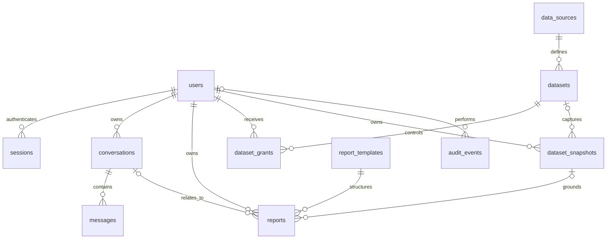

# Schema

The executable schema is `backend/app/schema.sql`. SQLite stores application metadata, separate from SQL Server business data. Version 1 creates the base tables; version 2 explicitly adds `data_sources.last_error` and `checked_at` in `Database.initialize`. Version 3 adds the separate `source_credentials` table for encrypted per-source connection settings. Version 4 adds `source_grants` for database-wide analysis permissions. Existing volumes migrate idempotently without losing users, chats, grants, or source definitions.

| Table | Purpose | Relationship |
| --- | --- | --- |
| `schema_migrations` | Applied schema versions | Version primary key |
| `users` | Workspace account/hash/role/status | Unique case-insensitive email |
| `sessions` | Hashed session tokens/expiry | User |
| `conversations` | Title/model/provider thread ID | User |
| `messages` | User/assistant text and completion status | Conversation |
| `data_sources` | Database metadata, status, sanitized last error, last check time | Admin-defined; no credentials |
| `source_grants` | Per-member access to automatic database discovery/analysis | Source + user; administrators have implicit access |
| `source_credentials` | Encrypted connection settings; excluded from API/model responses | Source + separate private volume key |
| `datasets` | Registered query key and parameter/column schemas | Source |
| `dataset_grants` | Per-member dataset access | Dataset + user |
| `dataset_snapshots` | Exact rows/provenance | User + optional dataset |
| `report_templates` | Purpose/desired sections | Executive, sales, operations |
| `reports` | Generation jobs/output/errors | User + template + snapshot; optional conversation |
| `audit_events` | Actor/action/target metadata | User |



## Input/output contracts

Report inputs include title/template, instructions, optional model/conversation, and **one of** manual scalar JSON rows, an authorized dataset ID/parameters, or a source ID with a validated `DatabaseQuery` plan. Automatic source reports need no dataset definition. Prototype limits are 500 rows, 100 columns per row, and 100 KB serialized data.

```json
{
  "title": "Report title",
  "summary": "Evidence-grounded summary",
  "sections": [{"heading": "Findings", "body": "Based on supplied data"}],
  "metrics": [{"label": "Metric", "value": "Formatted value", "explanation": "Definition and basis"}],
  "limitations": ["Known data gaps"]
}
```

`ReportDocument` defines the validation contract. Provider structured output is independently validated before completion. Backend snapshot provenance is independent of model-generated text.

Reports: `queued → running → completed | failed`, or `blocked` for unavailable data. Messages: `streaming → completed | failed | interrupted`. Startup reconciles unfinished work.

Future schema changes need explicit numbered migrations and old-volume upgrade tests. `CREATE TABLE IF NOT EXISTS` does not alter existing columns.
